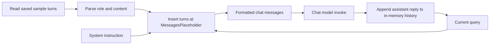
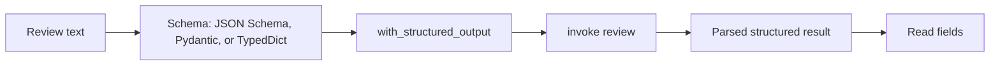

# LangChain Learning Journey

A collection of small Python examples documenting practical LangChain learning.

## Topics completed

- **Chat models:** invoke OpenAI-compatible models through OpenRouter, Gemini through `ChatGoogleGenerativeAI`, and hosted Hugging Face models through `HuggingFaceEndpoint` and `ChatHuggingFace`.
- **Embeddings and similarity:** create local Hugging Face and API-based embeddings, then rank sample documents with cosine similarity.
- **Prompts and Streamlit:** build and serialize a `PromptTemplate`, load it into a Streamlit UI, and submit static or selection-based prompts to a chat model. A chat prompt example also combines system and human templates with a history placeholder.
- **Model responses:** call models with `invoke()` and read chat output from `AIMessage.content`.
- **Message history:** represent system, human, and AI turns as message objects, include earlier turns in later model calls, and insert a history list into a `ChatPromptTemplate` with `MessagesPlaceholder`.
- **Structured output:** ask a chat model to return review data according to a JSON Schema, Pydantic model, or `TypedDict` schema. The examples compare these schema declarations; they do not yet validate untrusted model output in a larger application flow.

These are introductory examples; the command-line chatbot keeps history only in process memory and sends the full conversation on every turn. It does not yet implement durable chat storage, document retrieval, vector stores, or a complete RAG pipeline.

## Project structure

| Path | Learning example |
| --- | --- |
| `ChatModels/` | OpenRouter, Gemini, and Hugging Face chat model calls |
| `EmbeddedModels/` | Local/API embeddings and cosine similarity |
| `LLMS/` | Basic chat model invocation through OpenRouter |
| `Prompts/` | Prompt serialization, loading, and Streamlit interfaces |
| `chatbot/` | Chat prompt formatting, message objects, and a terminal chat loop |
| `Structured_output/` | Structured review extraction with JSON Schema, Pydantic, and `TypedDict`, plus standalone schema/type examples |
| `docs/practical-notes/` | PDF study notes on prompts, messages/history, chat models, embeddings, and coding revision |
| `hello.py` | Small chat message invocation example |
| `lecture3_notes.txt` | Lecture notes |
| `requirement.txt` | Python dependencies |

## Key APIs used

`ChatOpenAI`, `ChatGoogleGenerativeAI`, `ChatHuggingFace`, `HuggingFaceEndpoint`, `OpenAIEmbeddings`, `HuggingFaceEmbeddings`, `PromptTemplate`, `ChatPromptTemplate`, `MessagesPlaceholder`, `SystemMessage`, `HumanMessage`, `AIMessage`, `load_prompt()`, `embed_query()`, `embed_documents()`, `with_structured_output()`, `invoke()`, and scikit-learn's `cosine_similarity`.

## Learning entries

### Chat prompts and conversation history

#### Concept

A chat prompt is an ordered sequence of role-labeled messages. `MessagesPlaceholder` marks where a list of earlier turns should be inserted. This lets a prompt combine stable instructions, prior conversation, and the current question in one model input.

#### Why it is useful

Chat models need the relevant earlier turns in their input to answer follow-up questions coherently. A placeholder makes the history position explicit while keeping the system instruction and current question as separate parts of the prompt.

#### Important components

- `ChatPromptTemplate` defines the ordered message template and formats it when `invoke()` receives its variables.
- `MessagesPlaceholder(variable_name="chat_history")` accepts a variable-length sequence of messages at that position.
- `SystemMessage`, `HumanMessage`, and `AIMessage` represent instruction, user, and assistant turns. The prompt example also shows role/content tuples as a compact input representation.
- `ChatOpenAI.invoke(messages)` sends a list of messages to the configured chat model and returns an assistant message; `result.content` is the displayed text in the terminal example.
- `ast.literal_eval()` parses quoted content from the sample history file as a Python literal without evaluating arbitrary expressions. The surrounding line parser is custom code, not a LangChain history format.

#### Working flow

The diagram combines the two demonstrations: `message_placeholder.py` loads a sample history and formats a prompt, while `chatbot.py` repeatedly sends the accumulated messages to a model. The prompt example itself does not call a model.

#### Code understanding

`Prompts/message_placeholder.py` reads each line of `Prompts/chat_history.txt`, derives a role from the text before `(content=`, parses the content literal, and supplies the resulting role/content pairs to the chat template. The template places the history between its system instruction and the current human query. It prints the formatted prompt for inspection.

`chatbot/chat_prompt_template.py` demonstrates variable substitution for `{domain}` and `{topic}` in system and human messages. It formats a prompt but does not invoke a model; its imported message classes are unused in this file.

`chatbot/messages.py` constructs a system/human message list, invokes the model, and appends a new `AIMessage` built from the returned content. `chatbot/chatbot.py` starts with a system message, then on each input appends a human message, invokes the model with the full list, appends the reply, and prints it. Typing `exit` ends the loop. This is manual history management rather than a built-in persistent memory feature.

#### Important learning

- A prompt template formats model input; it does not call the model by itself.
- The model receives message objects (or supported role/content representations), not the Python variable named `chat_history` automatically. The caller must pass history into the prompt or model input.
- This example preserves context only for the lifetime of the running process. The sample text file is a separate, manually parsed input and is not updated by the chatbot loop.
- Keeping prior turns in the list makes context available, but token usage grows as the conversation grows. Production chat apps usually need a storage, trimming, or summarization strategy.

#### Common mistakes and limitations

- The file parser assumes a specific `HumanMessage(content=...)` / `AIMessage(content=...)` line representation and maps every non-human line to the AI role. It can misread system/tool messages and should not be treated as a general message serialization format.
- `open('Prompts/chat_history.txt')` uses a working-directory-relative path, so launching the script from another directory may fail. A path based on `__file__` is more robust.
- The interactive loop has no error handling, context limit, or persistence, and sends the entire accumulated history every turn.
- The examples implement basic history handling, not LangChain's newer runnable-based history integration or a production conversation store.
- `chatbot/chat_prompt_template.py` imports `SystemMessage` and `HumanMessage` without using them; this does not affect the demonstrated prompt formatting.

#### Interview preparation

1. **What does `MessagesPlaceholder` do?** It inserts a variable-length list of existing messages at a chosen position in a chat prompt.
2. **How does a chat prompt differ from a plain `PromptTemplate`?** It formats an ordered set of role-tagged messages rather than one undifferentiated text string.
3. **How does this chatbot retain conversational context?** It keeps earlier human and AI messages in a Python list and passes that full list to the model on each turn; the list is lost when the process ends.
4. **Does `ChatPromptTemplate.invoke()` call the LLM?** No. It formats prompt values into messages; a model invocation is a separate step.
5. **What is a risk of sending the entire history each time?** The prompt grows and can exceed model context limits or increase token cost; history needs a storage and truncation/summarization policy as the app grows.

#### Source files

`Prompts/message_placeholder.py`, `Prompts/chat_history.txt`, `chatbot/chat_prompt_template.py`, `chatbot/chatbot.py`, `chatbot/messages.py`, and `hello.py`.

### Structured output with schemas

#### Concept

Structured output asks a chat model to return data in a defined shape, such as a review summary with sentiment, pros, and cons. A schema communicates field names, types, allowed values, and descriptions. `ChatOpenAI.with_structured_output(schema)` binds that schema to the model and returns a runnable whose `invoke()` result is parsed into a Python representation.

#### Why it is useful

Applications can work with predictable fields instead of extracting values from free-form prose. This is useful for extraction and classification, though schema-constrained output still needs suitable error handling and application-level checks.

#### Important components

- `ChatOpenAI` configures the chat model. Here it uses the OpenRouter-compatible base URL and the `openai/gpt-4o-mini` model name.
- `with_structured_output()` creates a model wrapper configured with a schema. The examples use a JSON Schema dictionary, a Pydantic `BaseModel`, and a `TypedDict` class.
- `BaseModel` and `Field` describe fields and can validate/convert data when constructing a Pydantic object. `Literal` restricts a field to declared values; `Optional` means a value may be `None`, but in Pydantic v2 it does not by itself make the field omittable.
- `TypedDict` and `Annotated` describe a dictionary shape and attach field descriptions. They are typing/schema declarations and do not validate ordinary Python dictionaries at runtime.
- `invoke(review_text)` sends the review for extraction. The returned value is accessed as an object for the Pydantic example and as dictionary keys in the `TypedDict` example.

#### Working flow

#### Code understanding

The three `with_structured_output_*.py` examples send the same long phone review to the model and ask for themes, summary, sentiment, pros, cons, and reviewer name. `with_structured_output_json.py` writes the schema as a Python dictionary; `with_structured_output_pydantic.py` uses a `Review` model; and `with_structured_output_typeddict.py` describes the same shape with typed dictionary annotations. The latter two print selected returned fields. These examples demonstrate schema-driven extraction, not schema selection, retries, or downstream business validation.

`pydantic_demo.py` separately demonstrates Pydantic conversion and constraints: a string age is converted to an integer and `cgpa` is bounded when supplied. `EmailStr` also requires its optional email validation dependency at runtime. `typedict_demo.py` shows dictionary type annotations, but its `age` value is a string despite the declared `int`; Python does not reject this without a static type checker or explicit validator. `json_schema.json` is a separate student schema draft, not the schema loaded by the review examples.

#### Important learning

- The schema type affects the shape and ergonomics of the parsed result: Pydantic gives a model object; `TypedDict` is used like a dictionary; JSON Schema is provider-neutral schema data.
- Pydantic performs Python-side parsing and validation when a model is instantiated. `TypedDict` is primarily a static typing aid.
- Structured model output is an extraction result, not proof that every claim is correct or appropriate for the application.
- Schema descriptions guide extraction, while types and enums constrain representation. Keep descriptions and allowed values consistent.

#### Common mistakes and limitations

- In `with_structured_output_pydantic.py`, `Field("Return sentiment ...")` passes that string as the field's default, not its description. Use `Field(description="...")` if a description is intended. The field is also typed with `Literal["pos", "neg", "neutral"]`, while the JSON Schema example permits only `pos` and `neg`, even though its description mentions neutral.
- Optional fields in the Pydantic example have no defaults. With Pydantic v2, `Optional[...]` permits `None` but the field remains required unless a default is provided. Align this with the JSON Schema’s optional, nullable fields if omission is intended.
- `json_schema.json` is not used by the scripts and its `properties` entries are plain strings rather than JSON Schema property objects (for example, `{"type": "string"}`).
- The review strings visibly contain some mojibake punctuation, which can degrade the input text. The examples also have no handling for provider errors or invalid/missing fields.
- `langchain` 1.3.17 and Pydantic 2.13.4 are present in the inspected local Python environment, but `langchain_openai` is missing. The structured-output calls therefore could not be run or verified against the installed `langchain-openai` adapter and remote provider.

#### Interview preparation

1. **What does `with_structured_output()` do?** It configures a chat model to request schema-shaped output and parse the response into a corresponding Python result.
2. **How do Pydantic and `TypedDict` differ?** Pydantic model construction performs runtime parsing and validation; `TypedDict` primarily describes a dictionary shape for static type checking and does not enforce it at runtime.
3. **Does `Optional[str]` make a Pydantic v2 field optional to omit?** No. It allows `None`; provide a default such as `None` if the field may be omitted.
4. **Why include descriptions in a schema?** They clarify the meaning and expected content of fields to the model, especially when field names alone are ambiguous.
5. **Does schema-constrained output guarantee factual correctness?** No. It helps constrain representation, but the extracted content still needs appropriate validation and review.

#### Source files

`Structured_output/with_structured_output_json.py`, `Structured_output/with_structured_output_pydantic.py`, `Structured_output/with_structured_output_typeddict.py`, `Structured_output/pydantic_demo.py`, `Structured_output/typedict_demo.py`, and `Structured_output/json_schema.json`.

## Learning roadmap

Next: document loading and chunking, vector stores and retrievers, then a source-grounded RAG chain. After that, explore durable chat history, tools, and evaluation; continue structured-output practice with error handling and validated downstream use.

## Setup and secrets

Install the dependencies listed in `requirement.txt`. The Streamlit interfaces and local embedding example also use Streamlit and `sentence-transformers`, which are not listed there. Configure the provider credentials required by the examples in a local `.env`, and run scripts from the project directory. Run a prompt interface with Streamlit, for example `streamlit run Prompts/static_prompt_ui.py`.

`.env`, virtual environments, Python caches, and the temporary editor runner file are excluded through `.gitignore`. Never commit credentials.
